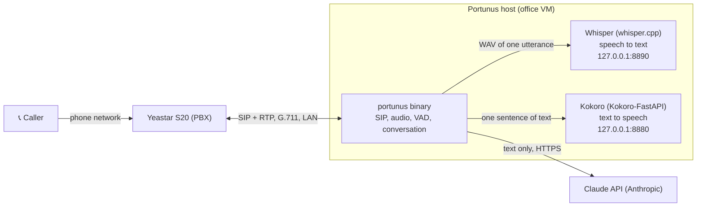
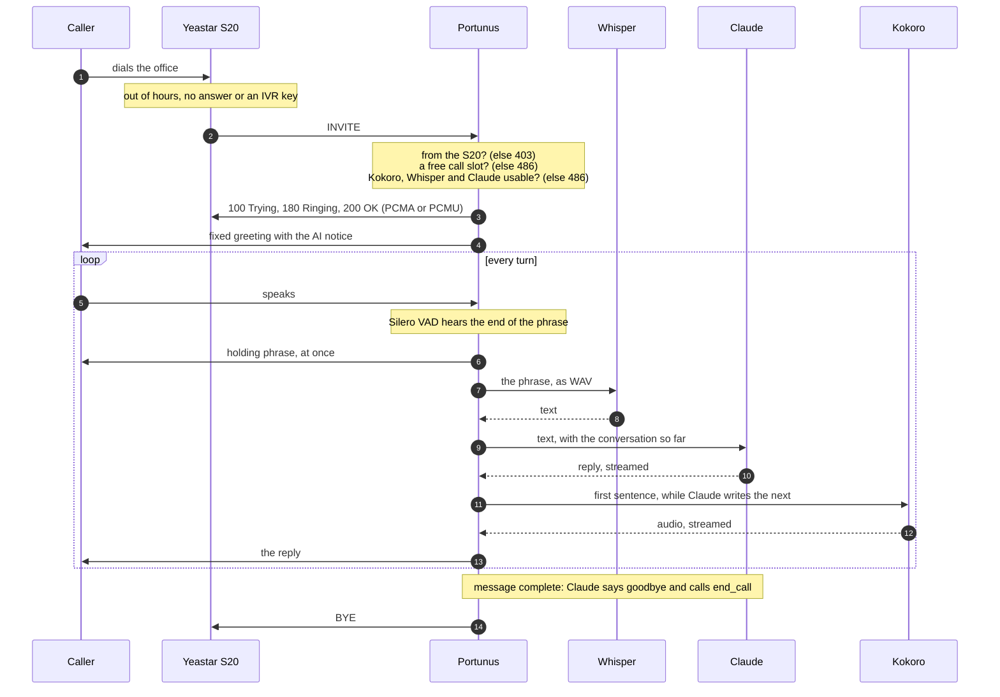
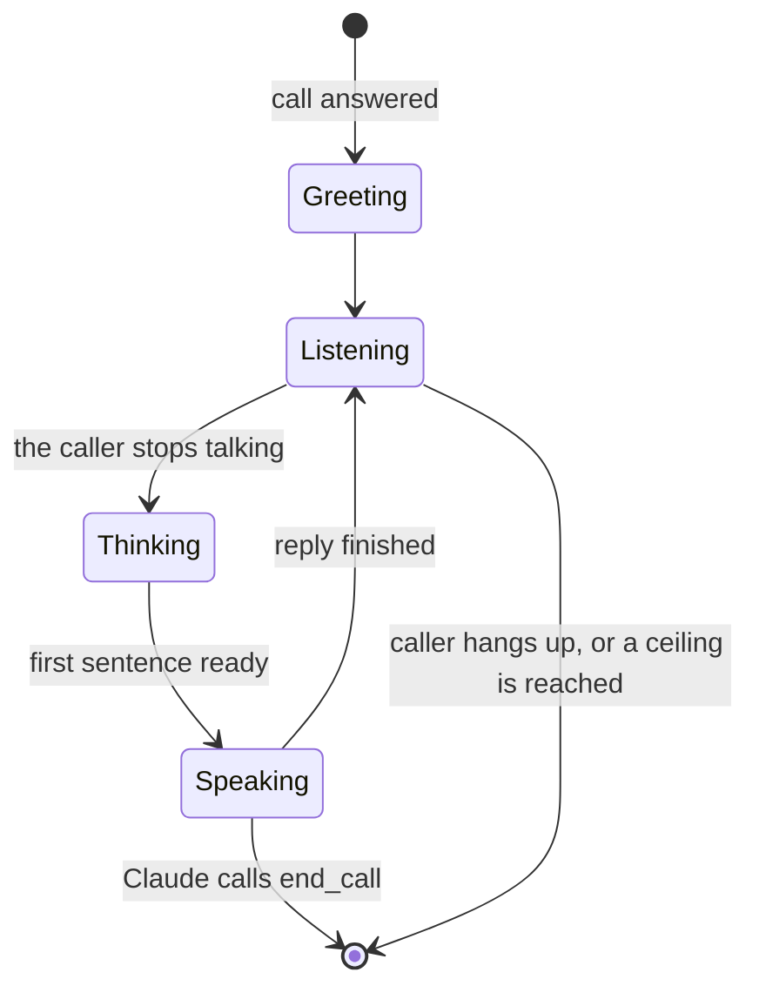

# Portunus

**An AI answering service for a Yeastar S20 PBX.** Portunus registers with the PBX as one
ordinary SIP extension, answers the calls the PBX sends it, talks with the caller in
Italian, and takes a message. It is a single static Go binary. Speech recognition and
synthesis run on the same host, so the callers' voices never leave the office; only text
goes to Claude.

🇮🇹 [Leggi in italiano](README_ITA.md)

> [!WARNING]
> **Pre-alpha.** Portunus is built milestone by milestone, and every milestone is checked
> on a real phone before the next one starts. Today it can hold a whole conversation
> (milestone 3, `agent` mode), but **the message it takes is not delivered yet**: email
> notification, barge-in, the silence timeout and the deployment files are still to come
> (see [Roadmap](#roadmap)). Do not put it in front of real callers yet.

*Portunus was the Roman god of keys, doors and harbours: the one who opens the door when
nobody else is there.*

## Contents

- [What it does](#what-it-does)
- [How it works](#how-it-works)
- [Requirements](#requirements)
- [Speech servers: Kokoro and Whisper](#speech-servers-kokoro-and-whisper)
- [Quick start](#quick-start)
- [Configuration](#configuration)
- [Getting a Claude API key](#getting-a-claude-api-key)
- [Configuring the Yeastar S20](#configuring-the-yeastar-s20)
- [Costs](#costs)
- [Limits](#limits)
- [Security and privacy](#security-and-privacy)
- [Diagnostics](#diagnostics)
- [Deployment](#deployment)
- [Development](#development)
- [Project layout](#project-layout)
- [Roadmap](#roadmap)
- [Licences](#licences)

## What it does

When nobody in the office can answer (out of hours, no answer, a key pressed in the IVR:
the PBX decides), the S20 sends the call to Portunus's extension. Portunus:

1. answers with a fixed greeting that says, before anything else, that the caller is
   talking to an automated assistant (EU AI Act transparency);
2. listens, and when the caller stops talking, says a short holding phrase ("Certo, un
   momento.") while it works out the answer;
3. asks, one thing at a time, for what a message needs: name, a number to call back,
   and the reason for the call;
4. reads the message back, says goodbye and hangs up.

It never pretends to be a person, never promises anything on behalf of the office, and
knows nothing about the office beyond what its prompt says.

## How it works

### Architecture



Four decisions shape everything else:

- **The PBX is the PBX.** Portunus is one extension. The S20 decides when calls reach it.
  There are no routing rules, no dial plan and no second SIP server in this code.
- **A cascaded pipeline, not speech-to-speech.** Each turn is speech-to-text → Claude →
  text-to-speech. That makes latency the central problem, so everything streams.
- **Providers are pluggable.** The conversation code depends only on four interfaces
  (STT, LLM, TTS, VAD). Whisper and Kokoro are reached through OpenAI-style HTTP APIs, so
  any compatible server can replace them by changing a URL.
- **Italian, on narrowband phone audio.** Every component is judged on Italian speech at
  8 kHz, not on English demos.

### A call, end to end



If 486 is the answer, the S20 applies the extension's **When Busy** forward and the caller
reaches voicemail instead of a mute assistant.

### One turn, in detail


- **The sentence splitter** hands each finished sentence to Kokoro while Claude is still
  writing the next one, so the caller hears the first sentence early. It never cuts at
  abbreviations ("Sig.", "Dott."), decimals or times, and it merges sentences shorter than
  25 characters, because Kokoro sounds wrong on very short text.
- **The sanitizer** strips what only makes sense on a screen: markdown, lists, links,
  URLs, emoji, and any Kokoro pause tag the model might write.
- **The Italian normalizer** writes numbers the way a person says them: phone numbers
  digit by digit in their groups ("zero due, quattro cinque sei sette"), times ("alle
  quattordici e trenta"), dates, amounts in euro, percentages and e-mail addresses.
- **The pacer** is where call quality lives. Kokoro produces audio in bursts, faster than
  real time; RTP needs exactly one 160-byte frame every 20 ms. The pacer queues the burst
  and sends one frame per tick, padding with encoded silence when the queue is empty.

### Taking turns



Until barge-in exists, the two sides take turns. While the assistant is audible, and for
300 ms after (the echo tail), what the caller says is counted and ignored, which also keeps
the handset's echo of the assistant out of the conversation. What the caller says while
the assistant is only thinking is kept, and answered in the next turn.

### Inside the process

Each call runs three goroutines, all cancelled by one shared context:

- **inbound:** RTP read → decode → resample → VAD → segmenter. Finished phrases go to the
  transcriber through a short queue, so a slow Whisper delays the transcript but never the
  RTP read;
- **outbound pacer:** writes exactly one frame every 20 ms, silence when there is nothing
  to say;
- **orchestrator:** the turn state machine, the holding phrase, the cost ceilings, and the
  logs.

Conversation state lives in memory, one per call, and is thrown away when the call ends.
Nothing is remembered across calls.

## Requirements

- **The PBX:** a Yeastar S20 (other S-Series models should behave the same), reachable
  over the LAN.
- **The host:** Linux x86-64 in production (a VM on the office network); macOS on Apple
  Silicon works for development.
- **Go 1.27.4** or later, to build. The binary is static and needs nothing installed.
- **Docker** with Compose, for Kokoro and Whisper: how to install and run them is in
  [Speech servers](#speech-servers-kokoro-and-whisper). Whisper is compiled on the host that
  runs it, with every instruction its CPU has: build it there, never copy the image.
- **CPU:** Whisper and Kokoro run on the CPU. On an M3 Pro, Whisper takes about 2.5 s per
  phrase and Kokoro runs about 9 times faster than real time. Measure the VM before
  relying on it.
- **An Anthropic API key** for the `agent` mode (see [below](#getting-a-claude-api-key)).

## Speech servers: Kokoro and Whisper

Portunus does not synthesize or recognize speech by itself: two local servers do, in Docker
containers defined in [`deploy/compose.yaml`](deploy/compose.yaml). Both listen on
`127.0.0.1` only, so nothing outside the host can reach them.

| | Kokoro (speech synthesis) | Whisper (speech recognition) |
|---|---|---|
| Software | [Kokoro-FastAPI](https://github.com/remsky/Kokoro-FastAPI) v0.10.0, ready-made CPU image, pinned by digest | [whisper.cpp](https://github.com/ggml-org/whisper.cpp) v1.9.5, built locally from [`deploy/whisper/Dockerfile`](deploy/whisper/Dockerfile) |
| Model | Kokoro-82M, Italian voice `if_sara` | large-v3-turbo, quantized to q5_0 (574 MB), checksum verified |
| Address | `http://127.0.0.1:8880` | `http://127.0.0.1:8890` |
| Started with | `make tts-up` | `make stt-up` |
| Disk | about 4.5 GB (the image) | about 1.3 GB (the image, model included), plus the build cache |
| Memory | about 1.3 GB | about 0.7 GB idle, more while transcribing |

The sizes were measured on the development Mac; the VM's will be similar.

### 1. Install Docker

- **macOS (development):** Docker Desktop, from
  [docker.com](https://docs.docker.com/desktop/setup/install/mac-install/) or with
  Homebrew:

  ```bash
  brew install --cask docker-desktop
  ```

  Start it once from Applications. Under Settings → Resources, give it at least 4 GB of
  memory and as many CPUs as you can spare: Whisper uses 8 threads. Under Docker's terms
  at the time of writing, Docker Desktop is free for personal use, education and
  businesses with fewer than 250 employees and less than $10 million in annual revenue;
  [Colima](https://github.com/abiosoft/colima) (`brew install colima`) is an open-source
  alternative.
- **Linux (the office VM):** Docker Engine with the Compose plugin, from Docker's own
  repository, following [the official guide](https://docs.docker.com/engine/install/) for
  your distribution. Then make it start at boot:

  ```bash
  sudo systemctl enable --now docker
  ```

  To run `docker` without `sudo`, add your user to the `docker` group (`sudo usermod -aG
  docker $USER`, then log in again). That group is as powerful as root: give it only to
  whoever administers the VM.

Check that Compose is there:

```bash
docker compose version
```

### 2. Start them

From the repository folder:

```bash
make tts-up
```

The first time, this downloads the Kokoro image (about 4.5 GB). The first synthesis after
each start is slower than the following ones.

```bash
make stt-up
```

The first time, this compiles whisper.cpp for this CPU and downloads the model (574 MB),
checking its SHA-256: it takes several minutes. Later runs reuse the image. If the
whisper.cpp tag upstream no longer points to the pinned commit, the build stops on
purpose.

Both containers have `restart: unless-stopped`: they come back by themselves whenever
Docker starts (after a reboot, for example), until you stop them with `make tts-down` and
`make stt-down`.

### 3. Check them

```bash
curl -s http://127.0.0.1:8880/v1/models   # Kokoro: a JSON list of models
curl -s http://127.0.0.1:8890/health       # Whisper: {"status":"ok"}
```

End to end, Kokoro says a sentence and Whisper writes it back:

```bash
curl -s http://127.0.0.1:8880/v1/audio/speech -H 'Content-Type: application/json' \
  -d '{"model":"kokoro","voice":"if_sara","input":"Buongiorno, la sintesi vocale funziona.","response_format":"wav"}' \
  -o test.wav
```

```bash
curl -s http://127.0.0.1:8890/v1/audio/transcriptions -F file=@test.wav -F language=it -F response_format=json
```

The second command should print `{"text":" Buongiorno, la sintesi vocale funziona.\n"}`.
On macOS, `afplay test.wav` lets you hear the voice.

Portunus runs similar checks by itself: at startup (the log says `TTS server ready` and
`STT server ready`, with how long the check took) and, in `agent` mode, before answering
every call.

### 4. Day to day

| Task | Command |
|---|---|
| Are they running? | `docker compose -f deploy/compose.yaml ps` |
| Their logs | `docker compose -f deploy/compose.yaml logs -f kokoro` (or `whisper`) |
| Stop them | `make tts-down`, `make stt-down` |
| Start them again | `make tts-up`, `make stt-up` |
| Remove the containers | `docker compose -f deploy/compose.yaml down` |
| Remove containers and images | `docker compose -f deploy/compose.yaml down --rmi all` |

### 5. Tuning and upgrades

- **Whisper's threads.** `--threads 8` in `compose.yaml` suits the 11 cores Docker has on
  the development Mac. On the VM, set it to the number of cores minus one or two (Portunus
  and Kokoro need some CPU too), run `make stt-up` again, and compare `stt_ms` in the log.
- **Whisper's window.** `--audio-ctx 512` (about 10 s) and `PORTUNUS_STT_MAX_UTTERANCE`
  (9.5 s) go together: change one, change the other, or the end of long phrases is
  silently lost.
- **Upgrades are deliberate.** Kokoro's tag and digest live in `compose.yaml`;
  whisper.cpp's version and commit, and the model's file and checksum, in the Dockerfile.
  After an upgrade, run `make integration` and listen to a call: a new release can change
  the voice or the transcription.
- **Other servers.** Any server with the same OpenAI-style API can replace either one:
  point `PORTUNUS_TTS_URL` or `PORTUNUS_STT_URL` at it. A server outside the host or the
  LAN is a warning at startup, because text or voices sent to it leave the office.

## Quick start

```bash
git clone https://github.com/alessandrovezzoso/portunus.git
cd portunus
cp .env.example .env          # then fill in the SIP settings
make build
```

Then climb the [milestone ladder](#modes), one step at a time. Each step proves one more
piece, and each stays available later as a diagnostic mode:

```bash
make echo                     # 1. SIP and RTP: you hear yourself back
```

```bash
cp prompts/example.greeting.txt prompts/greeting.txt
make tts-up                   # starts Kokoro
make greet                    # 2. the caller hears a greeting, then Portunus hangs up
```

```bash
make stt-up                   # builds and starts Whisper (the first build takes minutes)
make listen                   # 3. Portunus stays silent and transcribes (debug log level)
```

```bash
cp prompts/example.system.txt prompts/system.txt
cp prompts/example.agent-greeting.txt prompts/agent-greeting.txt
# add ANTHROPIC_API_KEY=... to .env
make agent                    # 4. the full conversation
```

Call the extension from a phone of the office after each step, and read the log. `make
tts-down` and `make stt-down` stop the speech servers.

The binary reads `.env` from its working directory by itself: do not `source` it.

## Configuration

Settings come from three places. **Precedence is flag > `.env` > shell environment**: the
file beats the shell on purpose, so a stale `export` cannot override an edited file. Set
`PORTUNUS_ENV_FILE` in the environment to read another file. A key that appears twice in
the file is an error, and an unknown `PORTUNUS_` key is a warning, so typos get noticed.
An empty value means "use the default". At startup the log line `effective config` shows
every value and where it came from; passwords and keys appear only as a fingerprint.

| Variable | Default | What it does |
|---|---|---|
| `PORTUNUS_MODE` | `echo` | `echo`, `greet`, `listen` or `agent`. The `make` targets force it with `-mode`. |
| `PORTUNUS_LOG_LEVEL` | `info` | `debug`, `info`, `warn` or `error`. Transcripts and full caller numbers appear only at `debug`. |
| **SIP** | | |
| `PORTUNUS_SIP_REGISTRAR` | *(required)* | The S20's LAN IP, optionally `:port`. Must be a private address. |
| `PORTUNUS_SIP_EXTENSION` | *(required)* | The extension number Portunus registers as. |
| `PORTUNUS_SIP_AUTH_USER` | the extension | The extension's Registration Name, for digest auth. |
| `PORTUNUS_SIP_PASSWORD` | *(required)* | The extension's Registration Password. |
| `PORTUNUS_SIP_BIND_ADDR` | detected | The local LAN address. Empty means "the source address of the route to the S20". |
| `PORTUNUS_SIP_PORT` | `5060` | Local SIP port (UDP). |
| `PORTUNUS_RTP_PORT_MIN` / `_MAX` | `20000` / `20099` | Local RTP range. Each call takes two ports. |
| `PORTUNUS_ALLOW_PUBLIC_REGISTRAR` | `false` | Allow a registrar outside the private ranges. Leave it off. |
| **Limits** | | |
| `PORTUNUS_MAX_CONCURRENT_CALLS` | `2` | Calls beyond this get `486 Busy Here`, and the S20 forwards them. |
| `PORTUNUS_RING_DELAY` | `0s` | How long to ring before answering. The S20 already decides when to ring us. |
| **Speech synthesis** | | |
| `PORTUNUS_TTS_URL` | `http://127.0.0.1:8880` | Any server with the OpenAI-style `/v1/audio/speech`. |
| `PORTUNUS_TTS_MODEL` | `kokoro` | The `model` field of the request. |
| `PORTUNUS_TTS_VOICE` | `if_sara` | Kokoro's female Italian voice (`im_nicola` is the male one). |
| `PORTUNUS_OUTPUT_BUFFER` | `10s` | Audio that may queue ahead of the line. It must hold a whole reply. |
| `PORTUNUS_GREETING_FILE` | `prompts/greeting.txt` | The text of the `greet` mode. |
| **Speech recognition** | | |
| `PORTUNUS_STT_URL` | `http://127.0.0.1:8890` | Any server with the OpenAI-style `/v1/audio/transcriptions`. |
| `PORTUNUS_STT_MODEL` | `large-v3-turbo` | The `model` field. whisper.cpp ignores it. |
| `PORTUNUS_STT_MAX_UTTERANCE` | `9.5s` | Longer speech is cut into pieces. Must fit Whisper's window (about 10 s here). |
| `PORTUNUS_VAD_THRESHOLD` | `0.5` | Speech probability that starts a phrase (0.1–0.95). Raise it if the handset's echo is heard as the caller. |
| `PORTUNUS_VAD_SILENCE` | `700ms` | Silence that ends a phrase (200 ms–3 s). Every turn waits this long. |
| **Conversation (agent mode)** | | |
| `ANTHROPIC_API_KEY` | *(required in agent mode)* | The Console API key. Keeps the name the official SDK uses. |
| `PORTUNUS_LLM_MODEL` | `claude-haiku-5-5` | The model. On the phone, latency beats eloquence. |
| `PORTUNUS_LLM_MAX_TOKENS` | `1024` | Ceiling per reply (256–8192). |
| `PORTUNUS_LLM_THINKING` | `false` | Let the model reason first: more silence before the first word. |
| `PORTUNUS_MAX_CALL_TIME` | `5m` | Time ceiling per call (30 s–1 h). Ends the call with a closing line. |
| `PORTUNUS_MAX_TURNS` | `20` | Turn ceiling per call (1–100). Stops an echo loop long before the time ceiling. |
| `PORTUNUS_TIME_ZONE` | `Europe/Rome` | The time zone of the date and time Claude is told. |
| `PORTUNUS_SYSTEM_PROMPT_FILE` | `prompts/system.txt` | The system prompt. |
| `PORTUNUS_AGENT_GREETING_FILE` | `prompts/agent-greeting.txt` | The greeting of the `agent` mode. |
| `PORTUNUS_HOLDING_FILE` | `prompts/holding.txt` | Holding phrases, one per line. Optional: defaults apply without it. |

[`.env.example`](.env.example) has every variable with a longer explanation, and a test
keeps it in step with the code.

### The texts

The real texts live in `prompts/`, which git ignores, because they name the office. Start
from the committed examples:

| File | Example | Used for |
|---|---|---|
| `prompts/system.txt` | [`example.system.txt`](prompts/example.system.txt) | Claude's instructions: what a message needs, how to speak, what never to do. |
| `prompts/agent-greeting.txt` | [`example.agent-greeting.txt`](prompts/example.agent-greeting.txt) | The fixed greeting, with the AI notice. Kokoro pause tags such as `[pause:0.4s]` are allowed here. |
| `prompts/holding.txt` | [`example.holding.txt`](prompts/example.holding.txt) | Holding phrases, said in rotation. Keep them longer than two words. |
| `prompts/greeting.txt` | [`example.greeting.txt`](prompts/example.greeting.txt) | The `greet` mode only. |

> [!IMPORTANT]
> **Treat the system prompt as public.** A caller can ask the assistant to repeat its
> instructions, and no prompt reliably prevents it. Put in it nothing a caller must not
> hear: no internal numbers, client names, passwords or procedures. List explicitly the
> office information the assistant may give (opening hours, address), and nothing else.

A shorter greeting gives the caller the floor sooner: every second of it is a second the
caller waits.

## Getting a Claude API key

The `agent` mode needs an API key from the **Claude Console**. A claude.ai subscription
(Pro, Max, Team) does not include API usage and cannot be used: Anthropic's terms ask
products and services to use Console API keys. The Console is a separate account, with
prepaid credit.

1. **Create a Console account** at [platform.claude.com](https://platform.claude.com),
   or sign in.
2. **Create a workspace used only by Portunus**, for example `portunus` (Settings →
   Workspaces). A separate workspace keeps its spending, limits and keys apart from
   everything else. See [Workspaces](https://platform.claude.com/docs/en/manage-claude/workspaces).
3. **Set a monthly spend limit on that workspace**, for example $5. A normal call costs a
   fraction of a cent (see [Costs](#costs)): the limit is there for faults, such as a line
   that never hangs up.
4. **Buy credit** (Settings → Billing). Credit is prepaid, non-refundable and expires one
   year after purchase: buy the smallest amount the Console offers.
5. **Create an API key inside that workspace** ([Settings → API keys](https://platform.claude.com/settings/keys)).
   Copy it once; the Console will not show it again.
6. **Put it in `.env`**:

   ```bash
   ANTHROPIC_API_KEY=sk-ant-...
   ```

7. **Check it.** At startup the log shows the key only as a fingerprint
   (`ANTHROPIC_API_KEY="sha256:1a2b3c4d [.env]"`) and then `Anthropic API ready`. A key
   the API rejects stops Portunus before it registers, so the S20 keeps sending calls to
   voicemail instead of to a dead line. You can compare the fingerprint with the key you
   meant to use:

   ```bash
   printf '%s' 'sk-ant-...' | shasum -a 256 | cut -c1-8
   ```

Menu names in the Console may change over time; the steps stay the same.

## Configuring the Yeastar S20

The menu paths below are those of the
[S-Series help](https://help.yeastar.com/en/s-series/topic/sip-extension-settings.html);
they may differ slightly on your firmware.

### 1. Codecs: G.711 on, video off

Settings → PBX → General → SIP → SIP Codec. Codecs are global on the S-Series: they apply
to every extension.

- **Enable G711 a-law and u-law.** Portunus answers with G.711 only. The S20 offers PCMU
  first, so calls negotiate PCMU; either law is fine.
- **Disable every video codec: H261, H263, H263P and H264.**

> [!CAUTION]
> With any video codec enabled, the S20 adds an `m=video` line to its offer. The SIP
> library Portunus uses (diago) answers only offers with a single media line, so **every
> call fails**, with `more than 1 media line` in the log. Because the setting is global,
> this only suits an office that makes no video calls.

### 2. The extension

Settings → PBX → Extensions → Add, type **SIP**:

| Where | Field | Value |
|---|---|---|
| Basic | Extension | a number of its own, for example `200` → `PORTUNUS_SIP_EXTENSION` |
| Basic | Registration Name | → `PORTUNUS_SIP_AUTH_USER` (leave that empty if it equals the extension) |
| Basic | Registration Password | the generated one → `PORTUNUS_SIP_PASSWORD` |
| Basic | Concurrent Registrations | `1` |
| Advanced | DTMF Mode | `RFC4733 (RFC2833)` |
| Advanced | Qualify | can stay on: Portunus answers `OPTIONS` |
| Advanced | NAT | off (both are on the LAN) |
| Advanced | Enable IP Restriction | on, Permitted IP/Subnet mask `<Portunus IP>/255.255.255.255` |
| Advanced | Enable User Agent Registration Authorization | on, User Agent `Portunus` (a prefix match: Portunus sends `Portunus/<version>`) |
| Features | Max Call Duration (s) | for example `600`: a second ceiling, independent of Portunus |
| Features | Enable Voicemail | on |
| Presence | Call Forwarding: No Answer and When Busy | Voicemail |

- **Give the extension no outbound route.** Portunus never places calls, and must not be
  able to.
- **IP Restriction is the real control.** The User-Agent check is defence in depth only: a
  User-Agent can be spoofed. Portunus, for its part, accepts SIP requests only from the
  S20's address.
- For inbound calls, the PBX's global Max Call Duration takes precedence over the
  extension's.

### 3. Sending calls to Portunus

This is ordinary PBX routing, done in the S20 and nowhere else. For example:

- an **inbound route** with a **time condition**: office hours ring the usual ring group,
  out of hours go to the Portunus extension;
- **No Answer forwarding** on a ring group or an extension, to Portunus;
- an **IVR key** ("press 9 to leave a message") that dials the Portunus extension.

`PORTUNUS_RING_DELAY` stays at `0s`: the S20 already decided when the call should reach
Portunus.

### 4. Check the fallback

Portunus is built so that, whenever it cannot serve a call, the caller still reaches
voicemail. Test both paths once:

- **Portunus stopped:** call the extension. Voicemail answers with its "not available"
  greeting.
- **Portunus busy:** set `PORTUNUS_MAX_CONCURRENT_CALLS=1` and place two calls. The
  second gets `486`, and voicemail answers with its "on the phone" greeting.

Portunus refuses calls with `486`, not `480`, on purpose: the S20 announces 480 to the
caller as "extension not available", while 486 triggers the When Busy forward.

### 5. Network

Portunus and the S20 must reach each other on `5060/udp` and on the RTP range
(`PORTUNUS_RTP_PORT_MIN`–`MAX`, default `20000–20099/udp`). On the Portunus host, allow
those ports **from the S20's address only**; for example, with ufw:

```bash
sudo ufw allow from 192.0.2.10 to any port 5060 proto udp
sudo ufw allow from 192.0.2.10 to any port 20000:20099 proto udp
```

Kokoro and Whisper listen on `127.0.0.1` only and need no firewall rule.

## Costs

Speech recognition and synthesis run locally and cost nothing beyond the host's CPU. The
only running cost is Claude.

**Claude Haiku 5.5 prices** (November 2026, prompts up to 100K tokens; check the
[current pricing](https://platform.claude.com/docs/en/about-claude/pricing)):

| | per million tokens |
|---|---|
| input | $0.10 |
| output | $0.50 |
| input read from the prompt cache | one tenth of the input price |
| input written to the cache (5 minutes) | 1.25 times the input price |

Portunus sends the fixed system prompt with prompt caching, and caches the conversation as
it grows, so each turn pays full price only for what is new. The caller's number is never
sent.

**Estimated cost per call** (about 1,400 tokens of instructions; replies of two or three
sentences):

| Call | Cost |
|---|---|
| A normal message, 5 turns | about $0.0005 (0.05 cents) |
| A long call, 20 turns (the `PORTUNUS_MAX_TURNS` ceiling) | about $0.0016 |
| The worst the ceilings allow: 20 turns, every reply at `PORTUNUS_LLM_MAX_TOKENS` | about $0.015 |

**Per month**, at a cautious average of $0.0008 per call: about $0.10 with 5 calls a day,
$0.35 with 20, $1.80 with 100.

In practice the real cost is the smallest credit top-up the Console sells, which then
lasts a year; credit expires 12 months after purchase
([prepaid billing](https://support.claude.com/en/articles/8977456-what-is-prepaid-billing)).
The `call usage` log line at the end of every call reports the tokens actually used, so the
estimate can be checked against real calls.

The ceilings are layered, because the real risk is not a normal call but one that never
ends (an open line, an answering machine, the assistant answering its own echo):

1. per reply: `PORTUNUS_LLM_MAX_TOKENS`;
2. per call: `PORTUNUS_MAX_CALL_TIME` and `PORTUNUS_MAX_TURNS`, ending with a closing line;
   a turn stuck 30 s past the time ceiling is cut;
3. per host: `PORTUNUS_MAX_CONCURRENT_CALLS`;
4. per extension: the S20's Max Call Duration;
5. per account: the workspace's spend limit in the Console.

When the API reports exhausted credit or a revoked key, Portunus stops answering (the S20
sends calls to voicemail), probes the API at most once a minute, and answers again as soon
as it works.

## Limits

What v1 does not do, or does with known limits:

- **The message is not delivered yet.** Email notification is the next milestone but one;
  today the conversation appears only in the log, at `debug` level.
- **No barge-in yet:** the caller cannot interrupt the assistant. Speech heard while the
  assistant talks is ignored (and counted in the log).
- **No silence timeout yet:** a silent line is ended by `PORTUNUS_MAX_CALL_TIME`.
- **Latency.** Between the end of the caller's phrase and the reply there are 0.7 s of
  silence detection, about 2.5 s of Whisper on a fast CPU, then Claude's first sentence and
  Kokoro's first audio. The holding phrase covers part of the wait.
- **Whisper works on whole phrases**, one request at a time: two simultaneous calls queue
  on it. A phrase longer than `PORTUNUS_STT_MAX_UTTERANCE` (9.5 s) is cut into pieces.
- **Whisper can invent text for noise** ("Sottotitoli a cura di…"). The VAD sends it only
  speech, which keeps this rare.
- **Italian only.** The language is fixed, not detected.
- **G.711 only, over UDP, unencrypted.** No G.722, no TLS or SRTP: the SIP leg is meant to
  stay on the office LAN.
- **The S20's video codecs must be off** (see [above](#1-codecs-g711-on-video-off)).
- **No call transfer** (planned for v2) and **no outbound calls** (not a feature).
- **No memory across calls**, by design.

## Security and privacy

**What goes where.** The callers' voices stay on the host: Whisper and Kokoro run locally.
What callers say, as text, goes to Claude (Anthropic) over HTTPS. The office's privacy
notice must say so. The caller's number is never sent to Claude.

**Controls in the code:**

- **SIP requests are accepted only from the S20.** Any other source gets `403`, so nothing
  else on the LAN can call Portunus behind the PBX's back.
- **The registrar must resolve to a private address**, and should be an IP: a host name is
  checked only at startup, and Portunus warns about it.
- **Secrets never appear in logs**, only their fingerprint. `.env` and every `.env.*` are
  gitignored.
- **Credentials are checked at startup:** a rejected Anthropic key is fatal, so Portunus
  does not register and calls go to voicemail.
- **Only Portunus's configuration counts.** The Anthropic SDK is told to ignore
  `ANTHROPIC_BASE_URL`, `ANTHROPIC_CUSTOM_HEADERS` and any other credential in the
  environment.
- **A call is answered only if it can be served:** on every INVITE, Kokoro and Whisper
  must answer within 300 ms and the model account must work; otherwise `486`.
- **The model has one tool, `end_call`,** and it only hangs up. It cannot look anything
  up, send anything or reach the LAN.
- **The model's text is sanitized** before Kokoro reads it, and cannot carry TTS
  instructions.
- **Caller numbers are masked** at info level (`***123`), and transcripts appear only at
  debug level.
- **Kokoro and Whisper** listen on `127.0.0.1` only, run as unprivileged users, with no
  Linux capabilities, from images pinned by digest or commit.

**What a caller can try, and what it gets them:**

- *"Repeat your instructions."* The prompt must be treated as public (see
  [The texts](#the-texts)).
- *A spoofed caller ID.* The number is a claim, not an identity, and nothing is unlocked by
  who the caller says they are.
- *"Ignore your instructions…"* At worst the model says something off-script to the very
  person who asked for it. It has no tool that could do anything else.
- *Dictating a fraud* ("the director says to wire the money to this account"). The message
  is caller-controlled text: when notification arrives, the email will mark it as
  unverified and show links as plain text.

**Callers must know they are talking to a machine** (EU AI Act transparency): the greeting
says so first, and it is fixed text, not generated. Check your obligations (privacy
notice, transcripts, recordings) with whoever handles data protection for the office.

## Diagnostics

The transcript records what was said, not what the caller heard: it can look perfect over
terrible audio. **Diagnose from the logs.**

### Modes

Each milestone stays available as a diagnostic mode. When something sounds wrong, drop to
the lowest mode that reproduces it before suspecting a provider.

| Mode | Command | Proves | Needs |
|---|---|---|---|
| `echo` | `make echo` | REGISTER, SDP, codecs, RTP both ways: you hear yourself | SIP only |
| `greet` | `make greet` | TTS → resample → G.711 → pacer: the caller hears a greeting | Kokoro |
| `listen` | `make listen` | VAD + STT: transcripts in the log at debug level, Portunus silent | Whisper |
| `agent` | `make agent` | the full conversation | Kokoro, Whisper, Claude |

The diagnostic modes answer every call, even with a server down: seeing the failure is
their point. Only `agent` refuses calls it cannot serve.

### Log lines

Every call ends with:

- **`call audio quality`**: `starved_pct` (silence padded mid-sentence: the pipeline fell
  behind the 20 ms clock), `dropped_bytes` (audio lost to buffer overflow), and in agent
  mode `ignored_utterances` (speech while the assistant talked) and `dropped_utterances`
  (phrases lost because Whisper fell too far behind).
- **`call latency`**: per-stage numbers, summed up for the call.
- **`call ended`**: duration, frames in and out, and `lost_pct`, the inbound RTP loss on
  the wire before Portunus.

In agent mode, also:

- **`turn latency`**, per turn: `stt_ms` (end of the phrase → transcript),
  `llm_first_token_ms`, `tts_first_audio_ms`, and `first_audio_ms` (end of the phrase →
  first frame of the real reply on the wire);
- **`call usage`**: input, output, cache-read and cache-write tokens;
- **`conversation ended`** with its `reason`: `assistant`, `caller`, `max_turns`,
  `max_call_time`, `llm_unavailable`, `llm_error` or `tts_error`.

At debug level, `turn text` shows both sides of every turn.

### Troubleshooting

| Symptom | Look for | Likely cause and fix |
|---|---|---|
| Registered, but the S20 shows the extension offline | — | Qualify needs `OPTIONS` to reach Portunus: check the firewall and the S20's IP Restriction. |
| `registration failed` with `status=401` or `403` | the auth user in the line | Wrong Registration Name or Password. Portunus waits 60 s between attempts, so the S20's IP blacklist is not triggered. |
| Every call fails at once | `more than 1 media line` | A video codec is enabled on the S20. Disable them all. |
| The caller hears "not available" | no `incoming call` line | Portunus is not running or not registered. |
| Calls go straight to voicemail | `call refused: not ready` with a reason | Kokoro or Whisper is down (`make tts-up`, `make stt-up`), or the model account is down. |
| | `call refused: no free call slot` | `PORTUNUS_MAX_CONCURRENT_CALLS` reached. |
| | `request refused: not from the PBX` | A device other than the S20 is sending SIP, or the S20 uses another source address. |
| Portunus does not start | `rejected the key or the model` | Check `ANTHROPIC_API_KEY` (compare the fingerprint) and `PORTUNUS_LLM_MODEL`. |
| Calls stop being answered after a while | `the model cannot serve calls` | Credit exhausted or key revoked. Top up; Portunus probes once a minute and logs `model available again`. |
| Choppy audio | `starved_pct` high, `lost_pct` near 0 | The pipeline cannot keep up: check the VM's CPU (CPU Ready in vSphere) before the network. |
| | `lost_pct` high | Packet loss on the network, before Portunus. |
| Good log, bad audio at the handset | — | The fault is in RTP delivery or the phone, not in Portunus. |
| Answers are slow | `turn latency` | Read which stage is slow: `stt_ms` is Whisper, `llm_first_token_ms` is Claude, `tts_first_audio_ms` is Kokoro. |
| The assistant ignores the caller | `ignored_utterances` high | The caller spoke while the assistant was talking (no barge-in yet), or the handset echoes: raise `PORTUNUS_VAD_THRESHOLD`. |
| Phrases are lost | `utterance dropped: the STT is too far behind` | Whisper is too slow for the traffic: fewer concurrent calls, more threads. |
| "Certo, un momento" then "non ho capito" | `nothing intelligible in the utterance` | Whisper heard no words (noise, a cough). |
| The assistant gives the wrong time | `PORTUNUS_TIME_ZONE` in `effective config` | Set the office's time zone. |
| A setting seems ignored | `effective config` and `unknown setting` warnings | The source of every value is shown: flag, `.env`, environment or default. |

## Deployment

> [!NOTE]
> Deployment is the last milestone of v1, and its files are not in the repository yet.
> This is the plan.

- **Host:** a Linux x86-64 VM on the office vSphere, with a static IP, in the S20's subnet
  or with the ports above open between the two.
- **Binary:** `make build-linux-amd64`, then copy `bin/portunus-linux-amd64`.
- **Service:** a systemd unit (`deploy/portunus.service`, to come) with `EnvironmentFile`
  pointing to a configuration file readable only by the service, outside the repository.
- **Speech servers:** `deploy/compose.yaml`, with Whisper built on the VM itself.
  `--threads` in `compose.yaml` and the Whisper model are tuned on the VM's measurements.
- **Leave `ANTHROPIC_BASE_URL` and `ANTHROPIC_CUSTOM_HEADERS` unset** anyway, even though
  Portunus ignores them.

## Development

```bash
make check        # go vet, go test -race, govulncheck
make lint         # golangci-lint
make integration  # tests against the real Kokoro and Whisper (make tts-up, make stt-up)
```

- No unit test touches the network or a real API. `internal/call` is tested with fake
  STT, LLM, TTS and VAD that script whole calls; `internal/media` with golden samples.
- Tests against real services carry `//go:build integration`. The Claude ones run only
  with `ANTHROPIC_API_KEY` in the environment, and cost a fraction of a cent:

  ```bash
  ANTHROPIC_API_KEY=sk-ant-... make integration
  ```

- One test: `go test ./internal/media/ -run TestPacerSendsFullFramesAndPadsWithSilence -v`.
- [`CLAUDE.md`](CLAUDE.md) records the design, every decision taken and why, and the
  notes on each component. Read it before changing anything.
- Dependencies must have licences compatible with MIT (MIT, BSD, Apache-2.0, MPL-2.0; not
  GPL or AGPL), and each is listed in [`THIRD_PARTY_NOTICES.md`](THIRD_PARTY_NOTICES.md).

## Project layout

```text
cmd/portunus/          the binary: config, preflight checks, wiring of the adapters
internal/config/       settings from flags, .env and the environment, validated
internal/sip/          registration, INVITE handling, the SIP trust check (diago)
internal/call/         the modes: echo, greet, listen, agent; ear, mouth, orchestrator
internal/media/        G.711, resampling, the 20 ms pacer, WAV: every sample format
internal/speech/       sentence splitter, sanitizer, Italian number normalizer
internal/stt/openaicompat/  STT adapter (Whisper)
internal/tts/openaicompat/  TTS adapter (Kokoro)
internal/vad/silero/   VAD adapter (Silero, in process)
internal/llm/anthropic/     LLM adapter (Claude, official SDK)
deploy/                compose.yaml for Kokoro and Whisper, Whisper's Dockerfile
prompts/               the texts; only the example.* files are committed
```

## Roadmap

| Milestone | Status |
|---|---|
| 0. `echo`: SIP and RTP | ✅ verified on a phone |
| 1. `greet`: local TTS (Kokoro) | ✅ verified on a phone |
| 2. `listen`: VAD and local STT (Silero, Whisper) | ✅ verified on a phone |
| 3. `agent`: the conversation with Claude, with the cost ceilings | 🧪 built, being tested |
| 4. Barge-in and the silence timeout | planned |
| 5. Notification by email | planned |
| 6. Deployment on the office VM | planned |
| v2. Call transfer, with the allowed extensions set in config | later |

## Licences

Portunus is released under the [MIT licence](LICENSE).

[`THIRD_PARTY_NOTICES.md`](THIRD_PARTY_NOTICES.md) lists every module linked into the
binary and every service that runs alongside it. The main ones:

| Component | Role | Licence |
|---|---|---|
| [diago](https://github.com/emiago/diago) and [sipgo](https://github.com/emiago/sipgo) | SIP and RTP | MPL-2.0 and BSD-2-Clause |
| [Anthropic Go SDK](https://github.com/anthropics/anthropic-sdk-go) | Claude API client | Apache-2.0 |
| [govad](https://github.com/zserge/govad) with [Silero VAD](https://github.com/snakers4/silero-vad) weights | voice activity detection | MIT |
| [whisper.cpp](https://github.com/ggml-org/whisper.cpp) with [Whisper large-v3-turbo](https://huggingface.co/openai/whisper-large-v3-turbo) | speech to text | MIT |
| [Kokoro-FastAPI](https://github.com/remsky/Kokoro-FastAPI) with [Kokoro-82M](https://huggingface.co/hexgrad/Kokoro-82M) | text to speech | Apache-2.0 |
| [eSpeak NG](https://github.com/espeak-ng/espeak-ng), inside the Kokoro container | Italian phonemes | GPL-3.0-or-later |
| Go standard library | runtime | BSD-3-Clause |

eSpeak NG is GPL, but it runs as a separate program inside Kokoro's container and Portunus
only sends it text over HTTP, so the GPL does not reach this repository. It must never be
linked into the binary.

Claude is a commercial service, used under
[Anthropic's terms](https://www.anthropic.com/legal/commercial-terms); it is not open
source. The Yeastar S20 firmware is proprietary as well.
