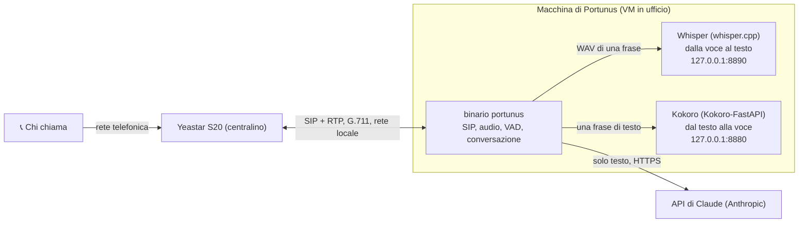
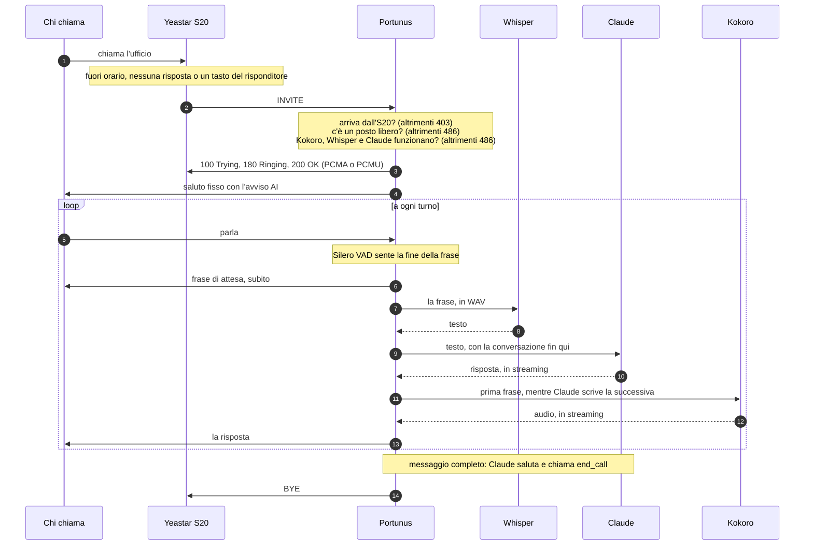
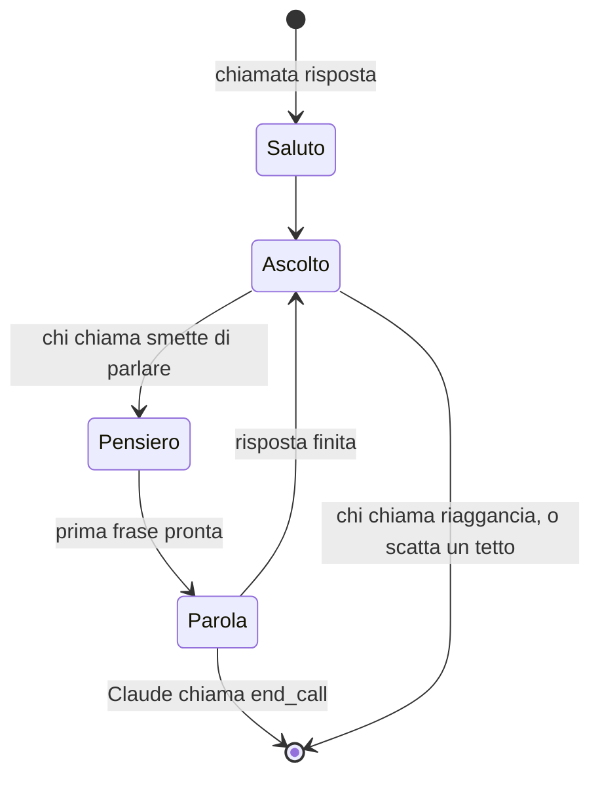

# Portunus

**Un centralino con intelligenza artificiale per lo Yeastar S20.** Portunus si registra sul
centralino come un normale interno SIP, risponde alle chiamate che il centralino gli
manda, parla con chi chiama in italiano e prende un messaggio. È un unico binario Go
statico. Il riconoscimento e la sintesi della voce girano sulla stessa macchina, quindi la
voce di chi chiama non esce mai dall'ufficio: a Claude arriva solo il testo.

🇬🇧 [Read in English](README.md)

> [!WARNING]
> **Pre-alpha.** Portunus viene costruito una tappa alla volta, e ogni tappa viene provata
> su un telefono vero prima di passare alla successiva. Oggi sa sostenere una conversazione
> intera (tappa 3, modalità `agent`), ma **il messaggio che prende non viene ancora
> consegnato a nessuno**: mancano ancora la notifica via email, l'interruzione da parte di
> chi chiama (barge-in), il timeout di silenzio e i file per la messa in produzione (vedi
> la [tabella di marcia](#tabella-di-marcia)). Non usatelo ancora con chiamate vere.

*Portunus era il dio romano delle chiavi, delle porte e dei porti: quello che apre la porta
quando non c'è nessun altro.*

## Indice

- [Cosa fa](#cosa-fa)
- [Come funziona](#come-funziona)
- [Requisiti](#requisiti)
- [Avvio rapido](#avvio-rapido)
- [Configurazione](#configurazione)
- [Ottenere una chiave API di Claude](#ottenere-una-chiave-api-di-claude)
- [Configurare lo Yeastar S20](#configurare-lo-yeastar-s20)
- [Costi](#costi)
- [Limiti](#limiti)
- [Sicurezza e privacy](#sicurezza-e-privacy)
- [Diagnostica](#diagnostica)
- [Messa in produzione](#messa-in-produzione)
- [Sviluppo](#sviluppo)
- [Struttura del progetto](#struttura-del-progetto)
- [Tabella di marcia](#tabella-di-marcia)
- [Licenze](#licenze)

## Cosa fa

Quando in ufficio nessuno può rispondere (fuori orario, nessuna risposta, un tasto premuto
nel risponditore: lo decide il centralino), l'S20 manda la chiamata all'interno di
Portunus. Portunus:

1. risponde con un saluto fisso che, prima di ogni altra cosa, dice a chi chiama che sta
   parlando con un assistente automatico (trasparenza richiesta dall'AI Act europeo);
2. ascolta e, appena chi chiama smette di parlare, dice una breve frase di attesa ("Certo,
   un momento.") mentre prepara la risposta;
3. chiede, una cosa alla volta, quello che serve per un messaggio: nome, un numero a cui
   richiamare e il motivo della chiamata;
4. ripete il messaggio per conferma, saluta e riaggancia.

Non finge mai di essere una persona, non promette niente a nome dell'ufficio e
dell'ufficio sa solo quello che c'è scritto nelle sue istruzioni.

## Come funziona

### Architettura



Quattro scelte determinano tutto il resto:

- **Il centralino fa il centralino.** Portunus è un interno. È l'S20 a decidere quando gli
  arrivano le chiamate: in questo codice non ci sono regole di instradamento, piani di
  numerazione o un secondo server SIP.
- **Una catena di passaggi, non un modello che fa tutto da solo.** Ogni turno è voce →
  testo → Claude → voce. Per questo il problema centrale è la latenza, e tutto lavora in
  streaming.
- **I fornitori sono intercambiabili.** Il codice della conversazione dipende solo da
  quattro interfacce (STT, LLM, TTS, VAD). Whisper e Kokoro si raggiungono con API HTTP in
  stile OpenAI: qualsiasi server compatibile può sostituirli cambiando un indirizzo.
- **Italiano, su audio telefonico.** Ogni componente viene giudicato sulla voce italiana a
  8 kHz, non su dimostrazioni in inglese.

### Una chiamata, dall'inizio alla fine



Se la risposta è 486, l'S20 applica il trasferimento **When Busy** dell'interno e chi
chiama finisce in segreteria invece che con un assistente muto.

### Un turno, nel dettaglio

```mermaid
flowchart LR
    rtp_in["RTP in ingresso<br/>G.711, 8 kHz"] --> dec["decodifica e<br/>ricampionamento a 16 kHz"]
    dec --> vad["Silero VAD<br/>(nel processo)"]
    vad --> seg["segmentatore<br/>fine frase dopo<br/>700 ms di silenzio"]
    seg --> stt["Whisper"]
    stt --> llm["Claude Haiku<br/>in streaming"]
    llm --> split["divisore in frasi"]
    split --> clean["pulitore e<br/>normalizzatore italiano"]
    clean --> tts["Kokoro<br/>PCM a 24 kHz"]
    tts --> enc["ricampionamento a 8 kHz<br/>e codifica G.711"]
    enc --> pacer["pacer<br/>un pacchetto ogni 20 ms"]
    pacer --> rtp_out["RTP in uscita"]
```



- **Il divisore in frasi** passa a Kokoro ogni frase appena è completa, mentre Claude scrive
  ancora la successiva: così chi chiama sente presto la prima frase. Non spezza mai sulle
  abbreviazioni ("Sig.", "Dott."), sui decimali o sugli orari, e unisce le frasi più corte
  di 25 caratteri, perché Kokoro legge male i testi molto brevi.
- **Il pulitore** toglie tutto quello che ha senso solo su uno schermo: markdown, elenchi,
  link, indirizzi web, emoji, e qualsiasi tag di pausa di Kokoro scritto dal modello.
- **Il normalizzatore italiano** scrive i numeri come li dice una persona: i numeri di
  telefono cifra per cifra, nei loro gruppi ("zero due, quattro cinque sei sette"), gli
  orari ("alle quattordici e trenta"), le date, gli importi in euro, le percentuali e gli
  indirizzi email.
- **Il pacer** è dove si decide la qualità della chiamata. Kokoro produce l'audio a
  raffiche, più veloce del tempo reale; l'RTP vuole esattamente un pacchetto da 160 byte
  ogni 20 ms. Il pacer accumula la raffica e manda un pacchetto a ogni scatto, riempiendo
  con silenzio codificato quando non ha niente da dire.

### Parlare uno alla volta



Finché non c'è il barge-in, si parla uno alla volta. Mentre l'assistente si sente, e per i
300 ms successivi (la coda dell'eco), quello che dice chi chiama viene contato e ignorato:
così anche l'eco dell'assistente nel telefono resta fuori dalla conversazione. Quello che
chi chiama dice mentre l'assistente sta solo pensando invece viene tenuto, e riceve
risposta al turno successivo.

### Dentro il processo

Ogni chiamata usa tre goroutine, fermate tutte insieme da un unico contesto:

- **ingresso:** lettura RTP → decodifica → ricampionamento → VAD → segmentatore. Le frasi
  finite passano alla trascrizione attraverso una coda corta: un Whisper lento ritarda la
  trascrizione, mai la lettura dell'RTP;
- **pacer in uscita:** scrive esattamente un pacchetto ogni 20 ms, silenzio quando non c'è
  niente da dire;
- **regia:** la macchina a stati dei turni, la frase di attesa, i tetti di costo e i log.

Lo stato della conversazione vive in memoria, uno per chiamata, e viene buttato via a fine
chiamata. Niente viene ricordato da una chiamata all'altra.

## Requisiti

- **Il centralino:** uno Yeastar S20 (gli altri modelli della serie S dovrebbero comportarsi
  allo stesso modo), raggiungibile dalla rete locale.
- **La macchina:** Linux x86-64 in produzione (una VM nella rete dell'ufficio); macOS su
  Apple Silicon va bene per lo sviluppo.
- **Go 1.27.4** o successivo, per compilare. Il binario è statico e non ha bisogno di
  niente di installato.
- **Docker** con Compose, per Kokoro e Whisper. Whisper viene compilato sulla macchina che
  lo usa, sfruttando tutte le istruzioni della sua CPU: compilatelo lì, non copiate mai
  l'immagine.
- **CPU:** Whisper e Kokoro girano sulla CPU. Su un M3 Pro, Whisper impiega circa 2,5 s
  per frase e Kokoro va circa 9 volte più veloce del tempo reale. Misurate la VM prima di
  contarci.
- **Una chiave API di Anthropic** per la modalità `agent` (vedi
  [sotto](#ottenere-una-chiave-api-di-claude)).

## Avvio rapido

```bash
git clone https://github.com/alessandrovezzoso/portunus.git
cd portunus
cp .env.example .env          # poi compilate i parametri SIP
make build
```

Poi salite la [scala delle tappe](#modi-di-funzionamento), un gradino alla volta. Ogni
gradino prova un pezzo in più, e resta disponibile in seguito come modalità di diagnosi:

```bash
make echo                     # 1. SIP e RTP: sentite la vostra voce
```

```bash
cp prompts/example.greeting.txt prompts/greeting.txt
make tts-up                   # avvia Kokoro
make greet                    # 2. chi chiama sente un saluto, poi Portunus riaggancia
```

```bash
make stt-up                   # compila e avvia Whisper (la prima volta ci vogliono minuti)
make listen                   # 3. Portunus resta zitto e trascrive (livello di log debug)
```

```bash
cp prompts/example.system.txt prompts/system.txt
cp prompts/example.agent-greeting.txt prompts/agent-greeting.txt
# aggiungete ANTHROPIC_API_KEY=... al file .env
make agent                    # 4. la conversazione completa
```

Dopo ogni gradino chiamate l'interno da un telefono dell'ufficio e leggete il log. `make
tts-down` e `make stt-down` spengono i server della voce.

Il binario legge da solo il `.env` della cartella da cui parte: non serve caricarlo con
`source`.

## Configurazione

I parametri arrivano da tre posti. **L'ordine di precedenza è: opzione da riga di comando
> `.env` > ambiente della shell.** Il file vince sulla shell apposta, così un vecchio
`export` non può scavalcare un file appena modificato. Per leggere un altro file, impostate
`PORTUNUS_ENV_FILE` nell'ambiente. Un nome ripetuto due volte nel file è un errore, e un
nome `PORTUNUS_` sconosciuto produce un avviso: così gli errori di battitura si notano. Un
valore vuoto vuol dire "usa il predefinito". All'avvio la riga di log `effective config`
mostra ogni valore e da dove arriva; password e chiavi compaiono solo come impronta.

| Variabile | Predefinito | A cosa serve |
|---|---|---|
| `PORTUNUS_MODE` | `echo` | `echo`, `greet`, `listen` o `agent`. I comandi `make` la impongono con `-mode`. |
| `PORTUNUS_LOG_LEVEL` | `info` | `debug`, `info`, `warn` o `error`. Le trascrizioni e i numeri completi di chi chiama compaiono solo a `debug`. |
| **SIP** | | |
| `PORTUNUS_SIP_REGISTRAR` | *(obbligatoria)* | L'IP dell'S20 nella rete locale, eventualmente con `:porta`. Deve essere un indirizzo privato. |
| `PORTUNUS_SIP_EXTENSION` | *(obbligatoria)* | Il numero di interno con cui Portunus si registra. |
| `PORTUNUS_SIP_AUTH_USER` | l'interno | Il Registration Name dell'interno, per l'autenticazione. |
| `PORTUNUS_SIP_PASSWORD` | *(obbligatoria)* | La Registration Password dell'interno. |
| `PORTUNUS_SIP_BIND_ADDR` | rilevato | L'indirizzo locale. Vuoto vuol dire "l'indirizzo da cui si esce verso l'S20". |
| `PORTUNUS_SIP_PORT` | `5060` | Porta SIP locale (UDP). |
| `PORTUNUS_RTP_PORT_MIN` / `_MAX` | `20000` / `20099` | Porte RTP locali. Ogni chiamata ne usa due. |
| `PORTUNUS_ALLOW_PUBLIC_REGISTRAR` | `false` | Ammette un centralino fuori dagli indirizzi privati. Lasciatelo spento. |
| **Limiti** | | |
| `PORTUNUS_MAX_CONCURRENT_CALLS` | `2` | Le chiamate in più ricevono `486 Busy Here` e l'S20 le trasferisce. |
| `PORTUNUS_RING_DELAY` | `0s` | Quanto squillare prima di rispondere. È già l'S20 a decidere quando farci squillare. |
| **Sintesi vocale** | | |
| `PORTUNUS_TTS_URL` | `http://127.0.0.1:8880` | Qualsiasi server con `/v1/audio/speech` in stile OpenAI. |
| `PORTUNUS_TTS_MODEL` | `kokoro` | Il campo `model` della richiesta. |
| `PORTUNUS_TTS_VOICE` | `if_sara` | La voce femminile italiana di Kokoro (`im_nicola` è quella maschile). |
| `PORTUNUS_OUTPUT_BUFFER` | `10s` | Audio che può accumularsi prima della linea. Deve contenere una risposta intera. |
| `PORTUNUS_GREETING_FILE` | `prompts/greeting.txt` | Il testo della modalità `greet`. |
| **Riconoscimento vocale** | | |
| `PORTUNUS_STT_URL` | `http://127.0.0.1:8890` | Qualsiasi server con `/v1/audio/transcriptions` in stile OpenAI. |
| `PORTUNUS_STT_MODEL` | `large-v3-turbo` | Il campo `model`. whisper.cpp lo ignora. |
| `PORTUNUS_STT_MAX_UTTERANCE` | `9.5s` | Un discorso più lungo viene diviso in pezzi. Deve stare nella finestra di Whisper (circa 10 s qui). |
| `PORTUNUS_VAD_THRESHOLD` | `0.5` | La probabilità di voce che fa iniziare una frase (0,1–0,95). Alzatela se l'eco del telefono viene scambiata per chi chiama. |
| `PORTUNUS_VAD_SILENCE` | `700ms` | Il silenzio che chiude una frase (200 ms–3 s). Ogni turno aspetta questo tempo. |
| **Conversazione (modalità agent)** | | |
| `ANTHROPIC_API_KEY` | *(obbligatoria in modalità agent)* | La chiave API della Console. Mantiene il nome che usa l'SDK ufficiale. |
| `PORTUNUS_LLM_MODEL` | `claude-haiku-5-5` | Il modello. Al telefono la velocità conta più dell'eleganza. |
| `PORTUNUS_LLM_MAX_TOKENS` | `1024` | Tetto per risposta (256–8192). |
| `PORTUNUS_LLM_THINKING` | `false` | Fa ragionare il modello prima di rispondere: più silenzio prima della prima parola. |
| `PORTUNUS_MAX_CALL_TIME` | `5m` | Tetto di durata per chiamata (30 s–1 h). Chiude la chiamata con una frase di congedo. |
| `PORTUNUS_MAX_TURNS` | `20` | Tetto di turni per chiamata (1–100). Ferma un'eco che si risponde da sola molto prima del tetto di durata. |
| `PORTUNUS_TIME_ZONE` | `Europe/Rome` | Il fuso orario della data e dell'ora che vengono dette a Claude. |
| `PORTUNUS_SYSTEM_PROMPT_FILE` | `prompts/system.txt` | Le istruzioni per Claude. |
| `PORTUNUS_AGENT_GREETING_FILE` | `prompts/agent-greeting.txt` | Il saluto della modalità `agent`. |
| `PORTUNUS_HOLDING_FILE` | `prompts/holding.txt` | Le frasi di attesa, una per riga. Facoltativo: senza, valgono quelle predefinite. |

In [`.env.example`](.env.example) c'è ogni variabile con una spiegazione più lunga, e un
test controlla che resti allineato al codice.

### I testi

I testi veri stanno in `prompts/`, che git ignora, perché contengono il nome dell'ufficio.
Partite dagli esempi presenti nel repository:

| File | Esempio | A cosa serve |
|---|---|---|
| `prompts/system.txt` | [`example.system.txt`](prompts/example.system.txt) | Le istruzioni per Claude: cosa serve per un messaggio, come parlare, cosa non fare mai. |
| `prompts/agent-greeting.txt` | [`example.agent-greeting.txt`](prompts/example.agent-greeting.txt) | Il saluto fisso, con l'avviso AI. Qui si possono usare i tag di pausa di Kokoro, come `[pause:0.4s]`. |
| `prompts/holding.txt` | [`example.holding.txt`](prompts/example.holding.txt) | Le frasi di attesa, dette a rotazione. Fatele più lunghe di due parole. |
| `prompts/greeting.txt` | [`example.greeting.txt`](prompts/example.greeting.txt) | Solo per la modalità `greet`. |

> [!IMPORTANT]
> **Considerate pubbliche le istruzioni.** Chi chiama può chiedere all'assistente di
> ripeterle, e nessuna istruzione lo impedisce con certezza. Non scriveteci niente che chi
> chiama non debba sentire: niente numeri interni, nomi di clienti, password o procedure.
> Elencate esplicitamente le informazioni sull'ufficio che l'assistente può dare (orari,
> indirizzo), e nient'altro.

Un saluto più corto lascia la parola a chi chiama prima: ogni secondo di saluto è un
secondo di attesa.

## Ottenere una chiave API di Claude

La modalità `agent` ha bisogno di una chiave API della **Claude Console**. Un abbonamento a
claude.ai (Pro, Max, Team) non comprende l'uso delle API e non si può usare: le condizioni
di Anthropic chiedono che prodotti e servizi usino le chiavi della Console. La Console è un
account separato, con credito prepagato.

1. **Create un account della Console** su [platform.claude.com](https://platform.claude.com),
   oppure accedete.
2. **Create un workspace usato solo da Portunus**, per esempio `portunus` (Settings →
   Workspaces). Un workspace a parte tiene spese, limiti e chiavi separati da tutto il
   resto. Vedi [Workspaces](https://platform.claude.com/docs/en/manage-claude/workspaces).
3. **Impostate un limite di spesa mensile su quel workspace**, per esempio 5 $. Una
   chiamata normale costa una frazione di centesimo (vedi [Costi](#costi)): il limite serve
   contro i guasti, come una linea che non riaggancia mai.
4. **Comprate il credito** (Settings → Billing). Il credito è prepagato, non rimborsabile
   e scade un anno dopo l'acquisto: comprate l'importo più piccolo che la Console propone.
5. **Create una chiave API dentro quel workspace**
   ([Settings → API keys](https://platform.claude.com/settings/keys)). Copiatela subito: la
   Console non la mostrerà più.
6. **Mettetela nel `.env`**:

   ```bash
   ANTHROPIC_API_KEY=sk-ant-...
   ```

7. **Controllatela.** All'avvio il log mostra la chiave solo come impronta
   (`ANTHROPIC_API_KEY="sha256:1a2b3c4d [.env]"`) e poi `Anthropic API ready`. Se l'API
   rifiuta la chiave, Portunus si ferma prima di registrarsi, così l'S20 continua a mandare
   le chiamate in segreteria invece che a una linea morta. Potete confrontare l'impronta
   con quella della chiave che intendevate usare:

   ```bash
   printf '%s' 'sk-ant-...' | shasum -a 256 | cut -c1-8
   ```

I nomi dei menu della Console possono cambiare nel tempo; i passaggi restano gli stessi.

## Configurare lo Yeastar S20

I percorsi dei menu qui sotto sono quelli della
[guida della serie S](https://help.yeastar.com/en/s-series/topic/sip-extension-settings.html);
sul vostro firmware possono essere leggermente diversi.

### 1. Codec: G.711 attivi, video disattivati

Settings → PBX → General → SIP → SIP Codec. Sulla serie S i codec sono globali: valgono per
tutti gli interni.

- **Attivate G711 a-law e u-law.** Portunus risponde solo in G.711. L'S20 propone prima
  PCMU, quindi le chiamate si accordano su PCMU; vanno bene entrambi.
- **Disattivate tutti i codec video: H261, H263, H263P e H264.**

> [!CAUTION]
> Con anche un solo codec video attivo, l'S20 aggiunge una riga `m=video` alla sua
> proposta. La libreria SIP usata da Portunus (diago) risponde solo a proposte con una
> sola riga media, quindi **tutte le chiamate falliscono**, con `more than 1 media line` nel
> log. Siccome l'impostazione è globale, va bene solo per un ufficio che non fa
> videochiamate.

### 2. L'interno

Settings → PBX → Extensions → Add, tipo **SIP**:

| Dove | Campo | Valore |
|---|---|---|
| Basic | Extension | un numero tutto suo, per esempio `200` → `PORTUNUS_SIP_EXTENSION` |
| Basic | Registration Name | → `PORTUNUS_SIP_AUTH_USER` (lasciatela vuota se coincide con l'interno) |
| Basic | Registration Password | quella generata → `PORTUNUS_SIP_PASSWORD` |
| Basic | Concurrent Registrations | `1` |
| Advanced | DTMF Mode | `RFC4733 (RFC2833)` |
| Advanced | Qualify | può restare attivo: Portunus risponde agli `OPTIONS` |
| Advanced | NAT | spento (sono entrambi nella rete locale) |
| Advanced | Enable IP Restriction | attivo, Permitted IP/Subnet mask `<IP di Portunus>/255.255.255.255` |
| Advanced | Enable User Agent Registration Authorization | attivo, User Agent `Portunus` (confronta l'inizio: Portunus manda `Portunus/<versione>`) |
| Features | Max Call Duration (s) | per esempio `600`: un secondo tetto, indipendente da Portunus |
| Features | Enable Voicemail | attivo |
| Presence | Call Forwarding: No Answer e When Busy | Voicemail |

- **Non date all'interno nessuna rotta in uscita.** Portunus non fa mai chiamate, e non
  deve poterle fare.
- **La vera protezione è l'IP Restriction.** Il controllo dello User-Agent è solo una
  difesa in più: uno User-Agent si può falsificare. Portunus, dal canto suo, accetta
  richieste SIP solo dall'indirizzo dell'S20.
- Per le chiamate in ingresso, il Max Call Duration globale del centralino prevale su
  quello dell'interno.

### 3. Mandare le chiamate a Portunus

È il normale instradamento del centralino, e si fa nell'S20 e da nessun'altra parte. Per
esempio:

- una **rotta in ingresso** con una **condizione oraria**: in orario d'ufficio squilla il
  solito gruppo, fuori orario va all'interno di Portunus;
- un **trasferimento su mancata risposta** di un gruppo o di un interno, verso Portunus;
- un **tasto del risponditore** ("premete 9 per lasciare un messaggio") che chiama
  l'interno di Portunus.

`PORTUNUS_RING_DELAY` resta a `0s`: l'S20 ha già deciso quando la chiamata deve arrivare a
Portunus.

### 4. Controllate la segreteria di riserva

Portunus è costruito in modo che, ogni volta che non può servire una chiamata, chi chiama
arrivi comunque in segreteria. Provate una volta entrambi i casi:

- **Portunus spento:** chiamate l'interno. Risponde la segreteria con il messaggio di "non
  disponibile".
- **Portunus occupato:** impostate `PORTUNUS_MAX_CONCURRENT_CALLS=1` e fate due chiamate.
  La seconda riceve `486`, e la segreteria risponde con il messaggio di "occupato".

Portunus rifiuta le chiamate con `486` e non con `480`, apposta: l'S20 annuncia il 480 a chi
chiama come "interno non disponibile", mentre il 486 fa scattare il trasferimento When
Busy.

### 5. Rete

Portunus e l'S20 devono potersi raggiungere sulla porta `5060/udp` e sulle porte RTP
(`PORTUNUS_RTP_PORT_MIN`–`MAX`, predefinite `20000–20099/udp`). Sulla macchina di Portunus,
aprite quelle porte **solo all'indirizzo dell'S20**; per esempio, con ufw:

```bash
sudo ufw allow from 192.0.2.10 to any port 5060 proto udp
sudo ufw allow from 192.0.2.10 to any port 20000:20099 proto udp
```

Kokoro e Whisper ascoltano solo su `127.0.0.1` e non hanno bisogno di regole del firewall.

## Costi

Il riconoscimento e la sintesi della voce girano in locale e non costano niente, a parte la
CPU della macchina. L'unico costo di esercizio è Claude.

**Prezzi di Claude Haiku 5.5** (novembre 2026, per richieste fino a 100.000 token;
controllate i [prezzi aggiornati](https://platform.claude.com/docs/en/about-claude/pricing)):

| | per milione di token |
|---|---|
| testo in ingresso | 0,10 $ |
| testo in uscita | 0,50 $ |
| ingresso letto dalla cache | un decimo del prezzo dell'ingresso |
| ingresso scritto nella cache (5 minuti) | 1,25 volte il prezzo dell'ingresso |

Portunus manda le istruzioni fisse con la cache dei prompt, e mette in cache anche la
conversazione man mano che cresce: ogni turno paga il prezzo pieno solo per la parte nuova.
Il numero di chi chiama non viene mai mandato.

**Costo stimato di una chiamata** (circa 1.400 token di istruzioni; risposte di due o tre
frasi):

| Chiamata | Costo |
|---|---|
| Un messaggio normale, 5 turni | circa 0,0005 $ (0,05 centesimi) |
| Una chiamata lunga, 20 turni (il tetto `PORTUNUS_MAX_TURNS`) | circa 0,0016 $ |
| Il peggio che i tetti permettono: 20 turni, tutte risposte al massimo di `PORTUNUS_LLM_MAX_TOKENS` | circa 0,015 $ |

**Al mese**, con una media prudente di 0,0008 $ a chiamata: circa 0,10 $ con 5 chiamate al
giorno, 0,35 $ con 20, 1,80 $ con 100.

In pratica il costo vero è la ricarica più piccola che la Console vende, che poi dura un
anno; il credito scade 12 mesi dopo l'acquisto
([credito prepagato](https://support.claude.com/en/articles/8977456-what-is-prepaid-billing)).
La riga di log `call usage`, alla fine di ogni chiamata, riporta i token davvero usati:
così la stima si può verificare sulle chiamate vere.

I tetti sono a più livelli, perché il vero rischio non è una chiamata normale, ma una che
non finisce mai (una linea rimasta aperta, una segreteria telefonica, l'assistente che
risponde alla propria eco):

1. per risposta: `PORTUNUS_LLM_MAX_TOKENS`;
2. per chiamata: `PORTUNUS_MAX_CALL_TIME` e `PORTUNUS_MAX_TURNS`, che chiudono con una
   frase di congedo; un turno bloccato da 30 s oltre il tetto di durata viene interrotto;
3. per macchina: `PORTUNUS_MAX_CONCURRENT_CALLS`;
4. per interno: il Max Call Duration dell'S20;
5. per account: il limite di spesa del workspace nella Console.

Quando l'API segnala il credito esaurito o una chiave revocata, Portunus smette di
rispondere (l'S20 manda le chiamate in segreteria), riprova l'API al massimo una volta al
minuto e torna a rispondere appena funziona.

## Limiti

Cosa la v1 non fa, o fa con limiti noti:

- **Il messaggio non viene ancora consegnato.** La notifica via email arriva fra due tappe;
  oggi la conversazione compare solo nel log, a livello `debug`.
- **Niente barge-in, per ora:** chi chiama non può interrompere l'assistente. Quello che
  dice mentre l'assistente parla viene ignorato (e contato nel log).
- **Niente timeout di silenzio, per ora:** una linea muta viene chiusa da
  `PORTUNUS_MAX_CALL_TIME`.
- **Latenza.** Tra la fine della frase di chi chiama e la risposta ci sono 0,7 s per
  riconoscere il silenzio, circa 2,5 s di Whisper su una CPU veloce, poi la prima frase di
  Claude e il primo audio di Kokoro. La frase di attesa copre una parte dell'attesa.
- **Whisper lavora su frasi intere**, una richiesta alla volta: due chiamate insieme fanno
  la coda. Una frase più lunga di `PORTUNUS_STT_MAX_UTTERANCE` (9,5 s) viene divisa in
  pezzi.
- **Whisper può inventare testo sul rumore** ("Sottotitoli a cura di…"). Il VAD gli manda
  solo voce, e questo lo rende raro.
- **Solo italiano.** La lingua è fissa, non viene riconosciuta.
- **Solo G.711, su UDP, senza cifratura.** Niente G.722, niente TLS o SRTP: la parte SIP
  deve restare nella rete locale dell'ufficio.
- **I codec video dell'S20 devono essere spenti** (vedi
  [sopra](#1-codec-g711-attivi-video-disattivati)).
- **Niente trasferimento di chiamata** (previsto per la v2) e **niente chiamate in uscita**
  (non è una funzione prevista).
- **Nessuna memoria tra una chiamata e l'altra**, per scelta.

## Sicurezza e privacy

**Cosa va dove.** La voce di chi chiama resta sulla macchina: Whisper e Kokoro girano in
locale. Quello che dice chi chiama, come testo, va a Claude (Anthropic) via HTTPS.
L'informativa privacy dell'ufficio deve dirlo. Il numero di chi chiama non viene mai
mandato a Claude.

**Le protezioni nel codice:**

- **Le richieste SIP vengono accettate solo dall'S20.** Qualsiasi altra provenienza riceve
  `403`: nient'altro nella rete locale può chiamare Portunus scavalcando il centralino.
- **Il centralino deve avere un indirizzo privato**, e conviene indicarlo come IP: un nome
  viene controllato solo all'avvio, e Portunus lo segnala.
- **I segreti non compaiono mai nei log**, solo la loro impronta. `.env` e ogni `.env.*`
  sono ignorati da git.
- **Le credenziali vengono controllate all'avvio:** una chiave Anthropic rifiutata ferma
  tutto, così Portunus non si registra e le chiamate vanno in segreteria.
- **Conta solo la configurazione di Portunus.** All'SDK di Anthropic viene detto di
  ignorare `ANTHROPIC_BASE_URL`, `ANTHROPIC_CUSTOM_HEADERS` e qualsiasi altra credenziale
  presente nell'ambiente.
- **Si risponde a una chiamata solo se la si può servire:** a ogni INVITE, Kokoro e Whisper
  devono rispondere entro 300 ms e l'account del modello deve funzionare; altrimenti `486`.
- **Il modello ha un solo strumento, `end_call`,** e serve solo a riagganciare. Non può
  cercare niente, mandare niente o raggiungere la rete locale.
- **Il testo del modello viene ripulito** prima che Kokoro lo legga, e non può contenere
  istruzioni per la sintesi vocale.
- **I numeri di chi chiama sono mascherati** a livello info (`***123`), e le trascrizioni
  compaiono solo a livello debug.
- **Kokoro e Whisper** ascoltano solo su `127.0.0.1`, girano con utenti senza privilegi,
  senza permessi Linux, da immagini bloccate per digest o per commit.

**Cosa può tentare chi chiama, e cosa ottiene:**

- *"Ripetimi le tue istruzioni."* Le istruzioni vanno considerate pubbliche (vedi
  [I testi](#i-testi)).
- *Un numero chiamante falso.* Il numero è una dichiarazione, non un'identità, e niente si
  sblocca in base a chi dice di essere chi chiama.
- *"Ignora le tue istruzioni…"* Al massimo il modello dice qualcosa fuori copione proprio a
  chi gliel'ha chiesto. Non ha strumenti con cui fare altro.
- *Dettare una truffa* ("il direttore dice di fare il bonifico su questo conto"). Il
  messaggio è testo deciso da chi chiama: quando arriverà la notifica, l'email lo
  segnalerà come non verificato e mostrerà i link come semplice testo.

**Chi chiama deve sapere che parla con una macchina** (trasparenza richiesta dall'AI Act):
il saluto lo dice per prima cosa, ed è un testo fisso, non generato. Verificate i vostri
obblighi (informativa privacy, trascrizioni, registrazioni) con chi si occupa della
protezione dei dati per l'ufficio.

## Diagnostica

La trascrizione registra cosa è stato detto, non cosa ha sentito chi chiama: può sembrare
perfetta anche con un audio pessimo. **Diagnosticate dai log.**

### Modi di funzionamento

Ogni tappa resta disponibile come modalità di diagnosi. Quando qualcosa si sente male,
scendete alla modalità più semplice che riproduce il problema, prima di sospettare di un
fornitore.

| Modalità | Comando | Cosa dimostra | Cosa serve |
|---|---|---|---|
| `echo` | `make echo` | REGISTER, SDP, codec, RTP nei due sensi: sentite la vostra voce | solo SIP |
| `greet` | `make greet` | TTS → ricampionamento → G.711 → pacer: chi chiama sente un saluto | Kokoro |
| `listen` | `make listen` | VAD + STT: trascrizioni nel log a livello debug, Portunus zitto | Whisper |
| `agent` | `make agent` | la conversazione completa | Kokoro, Whisper, Claude |

Le modalità di diagnosi rispondono a tutte le chiamate, anche con un server spento: vedere
il guasto è proprio il loro scopo. Solo `agent` rifiuta le chiamate che non può servire.

### Le righe di log

Ogni chiamata finisce con:

- **`call audio quality`**: `starved_pct` (silenzio inserito a metà frase: la catena non ha
  tenuto il passo dei 20 ms), `dropped_bytes` (audio perso perché il buffer era pieno), e in
  modalità agent `ignored_utterances` (voce mentre parlava l'assistente) e
  `dropped_utterances` (frasi perse perché Whisper era troppo indietro).
- **`call latency`**: i tempi di ogni passaggio, riassunti per la chiamata.
- **`call ended`**: durata, pacchetti in ingresso e in uscita, e `lost_pct`, la perdita di
  RTP in ingresso sulla rete, prima di Portunus.

In modalità agent, in più:

- **`turn latency`**, per ogni turno: `stt_ms` (fine della frase → trascrizione),
  `llm_first_token_ms`, `tts_first_audio_ms`, e `first_audio_ms` (fine della frase → primo
  pacchetto della risposta vera sulla linea);
- **`call usage`**: token in ingresso, in uscita, letti e scritti nella cache;
- **`conversation ended`** con il motivo (`reason`): `assistant`, `caller`, `max_turns`,
  `max_call_time`, `llm_unavailable`, `llm_error` o `tts_error`.

A livello debug, `turn text` mostra le due parti di ogni turno.

### Risoluzione dei problemi

| Sintomo | Cosa cercare | Causa probabile e rimedio |
|---|---|---|
| Registrato, ma l'S20 mostra l'interno non raggiungibile | — | Il Qualify ha bisogno che gli `OPTIONS` arrivino a Portunus: controllate il firewall e l'IP Restriction dell'S20. |
| `registration failed` con `status=401` o `403` | l'utente nella riga | Registration Name o Password sbagliati. Portunus aspetta 60 s tra un tentativo e l'altro, per non far scattare la lista nera automatica degli IP dell'S20. |
| Tutte le chiamate falliscono subito | `more than 1 media line` | Sull'S20 è attivo un codec video. Disattivateli tutti. |
| Chi chiama sente "non disponibile" | nessuna riga `incoming call` | Portunus non è avviato o non è registrato. |
| Le chiamate vanno dritte in segreteria | `call refused: not ready`, con il motivo | Kokoro o Whisper sono spenti (`make tts-up`, `make stt-up`), oppure l'account del modello non funziona. |
| | `call refused: no free call slot` | Raggiunto `PORTUNUS_MAX_CONCURRENT_CALLS`. |
| | `request refused: not from the PBX` | Un dispositivo diverso dall'S20 manda richieste SIP, oppure l'S20 usa un altro indirizzo di partenza. |
| Portunus non parte | `rejected the key or the model` | Controllate `ANTHROPIC_API_KEY` (confrontate l'impronta) e `PORTUNUS_LLM_MODEL`. |
| Dopo un po' le chiamate non ricevono più risposta | `the model cannot serve calls` | Credito esaurito o chiave revocata. Ricaricate; Portunus riprova una volta al minuto e scrive `model available again`. |
| Audio a scatti | `starved_pct` alto, `lost_pct` vicino a 0 | La catena non tiene il passo: controllate la CPU della VM (CPU Ready in vSphere) prima della rete. |
| | `lost_pct` alto | Pacchetti persi sulla rete, prima di Portunus. |
| Log a posto, audio brutto al telefono | — | Il guasto è nella consegna dell'RTP o nel telefono, non in Portunus. |
| Le risposte sono lente | `turn latency` | Guardate quale passaggio è lento: `stt_ms` è Whisper, `llm_first_token_ms` è Claude, `tts_first_audio_ms` è Kokoro. |
| L'assistente ignora chi chiama | `ignored_utterances` alto | Chi chiama ha parlato mentre parlava l'assistente (manca ancora il barge-in), oppure il telefono fa eco: alzate `PORTUNUS_VAD_THRESHOLD`. |
| Si perdono delle frasi | `utterance dropped: the STT is too far behind` | Whisper è troppo lento per il traffico: meno chiamate insieme, più thread. |
| "Certo, un momento" e poi "non ho capito" | `nothing intelligible in the utterance` | Whisper non ha sentito parole (rumore, un colpo di tosse). |
| L'assistente sbaglia l'ora | `PORTUNUS_TIME_ZONE` in `effective config` | Impostate il fuso orario dell'ufficio. |
| Un parametro sembra ignorato | `effective config` e gli avvisi `unknown setting` | Per ogni valore è indicata la provenienza: opzione, `.env`, ambiente o predefinito. |

## Messa in produzione

> [!NOTE]
> La messa in produzione è l'ultima tappa della v1, e i suoi file non sono ancora nel
> repository. Questo è il piano.

- **Macchina:** una VM Linux x86-64 sul vSphere dell'ufficio, con IP statico, nella stessa
  sottorete dell'S20 oppure con le porte indicate sopra aperte tra le due.
- **Binario:** `make build-linux-amd64`, poi copiate `bin/portunus-linux-amd64`.
- **Servizio:** un'unità systemd (`deploy/portunus.service`, in arrivo) con
  `EnvironmentFile` che punta a un file di configurazione leggibile solo dal servizio, fuori
  dal repository.
- **Server della voce:** `deploy/compose.yaml`, con Whisper compilato sulla VM stessa. I
  `--threads` in `compose.yaml` e il modello di Whisper si regolano sulle misure fatte
  sulla VM.
- **Lasciate comunque vuote `ANTHROPIC_BASE_URL` e `ANTHROPIC_CUSTOM_HEADERS`**, anche se
  Portunus le ignora.

## Sviluppo

```bash
make check        # go vet, go test -race, govulncheck
make lint         # golangci-lint
make integration  # test con Kokoro e Whisper veri (make tts-up, make stt-up)
```

- Nessun test unitario tocca la rete o un'API vera. `internal/call` viene provato con STT,
  LLM, TTS e VAD finti che recitano chiamate intere; `internal/media` con campioni di
  riferimento.
- I test con i servizi veri hanno `//go:build integration`. Quelli con Claude girano solo
  con `ANTHROPIC_API_KEY` nell'ambiente, e costano una frazione di centesimo:

  ```bash
  ANTHROPIC_API_KEY=sk-ant-... make integration
  ```

- Un solo test: `go test ./internal/media/ -run TestPacerSendsFullFramesAndPadsWithSilence -v`.
- [`CLAUDE.md`](CLAUDE.md) (in inglese) raccoglie il progetto, ogni decisione presa con il
  suo perché, e le note su ogni componente. Leggetelo prima di cambiare qualcosa.
- Le dipendenze devono avere licenze compatibili con MIT (MIT, BSD, Apache-2.0, MPL-2.0;
  non GPL né AGPL), e ognuna è elencata in
  [`THIRD_PARTY_NOTICES.md`](THIRD_PARTY_NOTICES.md).

## Struttura del progetto

```text
cmd/portunus/          il binario: configurazione, controlli all'avvio, collegamento degli adattatori
internal/config/       parametri da opzioni, .env e ambiente, validati
internal/sip/          registrazione, gestione degli INVITE, controllo della provenienza (diago)
internal/call/         le modalità: echo, greet, listen, agent; orecchio, bocca, regia
internal/media/        G.711, ricampionamento, pacer da 20 ms, WAV: ogni formato audio
internal/speech/       divisore in frasi, pulitore, normalizzatore dei numeri italiani
internal/stt/openaicompat/  adattatore STT (Whisper)
internal/tts/openaicompat/  adattatore TTS (Kokoro)
internal/vad/silero/   adattatore VAD (Silero, nel processo)
internal/llm/anthropic/     adattatore LLM (Claude, SDK ufficiale)
deploy/                compose.yaml per Kokoro e Whisper, Dockerfile di Whisper
prompts/               i testi; nel repository ci sono solo i file example.*
```

## Tabella di marcia

| Tappa | Stato |
|---|---|
| 0. `echo`: SIP e RTP | ✅ provata al telefono |
| 1. `greet`: sintesi vocale locale (Kokoro) | ✅ provata al telefono |
| 2. `listen`: VAD e riconoscimento vocale locale (Silero, Whisper) | ✅ provata al telefono |
| 3. `agent`: la conversazione con Claude, con i tetti di costo | 🧪 costruita, in prova |
| 4. Barge-in e timeout di silenzio | prevista |
| 5. Notifica via email | prevista |
| 6. Messa in produzione sulla VM dell'ufficio | prevista |
| v2. Trasferimento di chiamata, con gli interni ammessi decisi nella configurazione | più avanti |

## Licenze

Portunus è distribuito con [licenza MIT](LICENSE).

[`THIRD_PARTY_NOTICES.md`](THIRD_PARTY_NOTICES.md) elenca ogni modulo incluso nel binario e
ogni servizio che gli gira accanto. I principali:

| Componente | Ruolo | Licenza |
|---|---|---|
| [diago](https://github.com/emiago/diago) e [sipgo](https://github.com/emiago/sipgo) | SIP e RTP | MPL-2.0 e BSD-2-Clause |
| [SDK Go di Anthropic](https://github.com/anthropics/anthropic-sdk-go) | client dell'API di Claude | Apache-2.0 |
| [govad](https://github.com/zserge/govad) con i pesi di [Silero VAD](https://github.com/snakers4/silero-vad) | riconoscimento della voce | MIT |
| [whisper.cpp](https://github.com/ggml-org/whisper.cpp) con [Whisper large-v3-turbo](https://huggingface.co/openai/whisper-large-v3-turbo) | dalla voce al testo | MIT |
| [Kokoro-FastAPI](https://github.com/remsky/Kokoro-FastAPI) con [Kokoro-82M](https://huggingface.co/hexgrad/Kokoro-82M) | dal testo alla voce | Apache-2.0 |
| [eSpeak NG](https://github.com/espeak-ng/espeak-ng), dentro il container di Kokoro | fonemi italiani | GPL-3.0-or-later |
| Libreria standard di Go | runtime | BSD-3-Clause |

eSpeak NG è GPL, ma gira come programma separato dentro il container di Kokoro, e Portunus
gli manda solo testo via HTTP: la GPL non arriva a questo repository. Non deve mai essere
incluso nel binario.

Claude è un servizio commerciale, usato secondo le
[condizioni di Anthropic](https://www.anthropic.com/legal/commercial-terms); non è open
source. Anche il firmware dello Yeastar S20 è proprietario.
